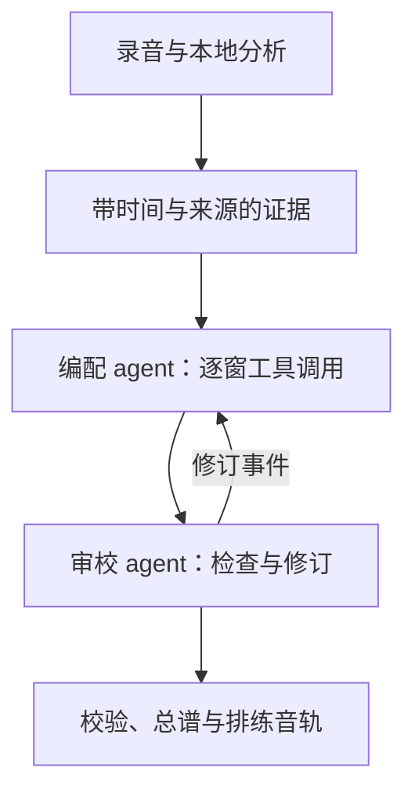

# Vibacappella Agent

从录音出发，调用本地音乐分析工具和 API LLM，生成 **Lead + SATB + VP + Whistle** 总谱、分谱与排练音轨。源码独立于 EYKM 的曲式、调性和 3/4 拍；不会把旧编曲的固定和弦表当作通用编曲器。

这是可运行的 **0.1 工程版本**。离线 agent/导出完整示例及自动测试已落地；真实 LLM 的音乐判断仍需接入你选择的服务后验证。它交付的状态是 `exported_draft_needs_review`，不会把结构检查通过称为真人听审通过。

## 从 v1–v3 吸取的经验

| 过去的问题 | 当前工作流中的约束 |
|---|---|
| 凭固定和弦模板改掉原曲色彩 | 分离转写作为证据，保留半小节和声候选、延伸音、sus 和转位；参考和声可锁定；检查实际发声音集合里的色彩音和低音 |
| 钢琴主题被误作口哨 | 口哨音符必须引用标记为 flute 且达到阈值的证据；`other` 与 piano 不自动成为 flute |
| 钢琴变成机械柱式/琶音 | 工具按原起音、原音高类和空隙分配 S/A/T；LLM 分段选择织体并能逐事件修订 |
| 背景人声消失 | `vocal_backing` 与 `harmonic_support` 分开记账，缺失背景层会报警；候选背景不冒充已确认的原演唱 |
| VP 没设计或照抄多件鼓同时发声 | 使用鼓组起音证据，按段选择疏密、推进与收束；每格只一个口技动作，保留释放/吸气空隙 |
| 谱与音轨不一致 | 同一事件谱导出；对 8 份 MusicXML/MIDI 逐格/逐音核对；记录实际音频引擎、音库哈希与时长 |
| 重跑耗时、覆盖旧成果 | 独立 run 目录、分析缓存、对话检查点、事件日志、事件谱修订快照与导出校验单 |

原过程记录：[v3 技术报告](../docs/TECHNICAL_REPORT_V3_ZH.md)。原有 v1/v2/v3 音乐成品保留。

## 工作流



1. **准备**：输入快照与 SHA-256；FFmpeg 转为统一 WAV；Demucs 六轨，或使用已有同起点、同长度分轨。
2. **分析**：Basic Pitch 音符候选；可选 GAME 主唱转写；节拍/速度映射、半小节和声候选、分频段鼓起音。保留不确定性。
3. **编配**：每次最多 8 小节。LLM 调用 `inspect_bars`、`choose_harmony`、`assign_vocal_roles`、`arrange_bars`、`replace_events`、`validate`、`finish`，而不是一次吐出整首谱。主唱/背景/泛音的角色解释另存覆盖层，不改写原始候选。
4. **审校**：使用同一个 API 模型、全新的审校上下文独立再看证据、修订事件。不是两个 Python 进程假装两个 LLM，也不要求多份 API KEY。
5. **导出**：总谱与 7 分谱的 MusicXML、MIDI、PDF；全混音、7 独立声部、7 突出声部练习音轨、去主唱伴奏；本地 `review.html`。
6. **复核**：谱/音轨一致性、缺失色彩音、转位、音域、来源归属、延音、单声部重叠、声部交叉与呼吸；未解决的警告进入交付记录。

和声检查验证的是每段色彩音是否出现，并不证明整段配器、和弦听辨或每个瞬时垂直和声都正确。音域、时值与来源错误会阻止成功交付；交叉、长乐句、部分候选没采用等保留为可审阅警告。

## 安装

建议 Python **3.11** 或 **3.12**。编排/HTTP/校验/基本 MusicXML 与 MIDI 代码只用标准库；音频依赖在独立解释器中运行，避免强迫模型栈共享同一个环境。

```sh
cd agent_system
python3.11 -m venv .venv
. .venv/bin/activate
python -m pip install -e '.[audio,samples,pdf]'
```

还需 FFmpeg、一个本地 SF2/SF3 音库，以及 MuseScore（用于正式 PDF）或含音乐符号的 FreeSerif 字体（用于 proof PDF）。模型首次运行可能下载权重；本项目不捆绑模型、字体或音库。Demucs/Basic Pitch 与其依赖的兼容性由各自版本约束决定；若安装困难，可分离 `analysis.python` 与 `render.python` 环境。GAME 是可选能力，需安装 `.[game]` 并配置它自己的 ONNX 模型目录。

无需安装包也可从本目录执行 `python3 -m vibacappella ...`。

本机已有依赖的路径记录在 [examples/local-macos.toml](examples/local-macos.toml)，可以直接用来跑示例。代码本身没有引用旧项目的曲目数据或固定依赖路径；该配置使用旧项目已安装的 Python 环境。

## Prime Inference（默认）

按 [Prime 官方文档](https://docs.primeintellect.ai/inference/overview) 接入 OpenAI 兼容接口 `https://api.pinference.ai/api/v1/chat/completions`。默认示例模型为 `z-ai/glm-5.3`；可在 `PRIME_MODEL` 中指定模型目录的完整 ID，具体工具能力和参数限制以目录为准。尚未使用真实 Prime Key 验证模型调用。

将 Key 填入 `agent_system/secrets/prime.env`（已有文件请直接编辑，不要覆盖）：

```dotenv
PRIME_API_KEY=你的Key
# 可选：PRIME_MODEL=模型目录中的完整ID
# 可选：PRIME_TEAM_ID=团队ID
```

Key 需具备 Inference 权限。文件格式参考 `secrets/prime.env.example`，支持 `NAME=value`、引号和 `export NAME=value`；只读取字面值，不执行脚本。环境变量优先。相对密钥路径以 `agent_system` 为基准，不随运行目录变化。密钥运行时读取，不写入配置和日志，也不导出给子进程。`secrets` 中的实际文件已加入忽略规则。

默认从个人账户扣费；设置 `PRIME_TEAM_ID` 时每个请求附带 `X-Prime-Team-ID`。请求包含 `usage.include`，使用响应 token 数更新预算。

```sh
cd agent_system
python3 -m vibacappella doctor --config examples/local-macos.toml
python3 -m vibacappella run path/to/song.wav --config examples/local-macos.toml --run-dir runs/prime-01
```

`examples/local-macos.toml` 已切到 Prime；通用配置为 `examples/prime.toml`。已有 run 保留原配置，迁移需通过 `resume --config` 显式指定兼容的分析/编配配置。原 Parley 专用示例继续保留。

## Parley / API 配置

已于 2026-11-13 通过登录后的 [MIT Parley 文档](https://parley-docs.mit.edu/chat-completions)核对：使用 `https://parley.api.mit.edu/v1/chat/completions`、Bearer 鉴权和 OpenAI 格式的工具调用。现有传输层与该基本协议匹配；随后已用真实 Key 验证 Sonnet 4.6 与 Sonnet 5.5 的两轮工具调用。

[examples/parley.toml](examples/parley.toml) 已填好 Parley API base URL。默认模型为 `claude-sonnet-5-5`，Key 只在终端手动输入。例如在 macOS 默认 zsh 中：

```sh
export PARLEY_MODEL='claude-sonnet-5-5' # 已通过两轮真实工具调用测试
read -s 'PARLEY_API_KEY?Parley API Key: '; echo
export PARLEY_API_KEY
```

`PARLEY_BASE_URL` 可覆盖配置中的地址，通常无需设置。2026-11-13 两轮真实工具调用：Sonnet 4.6 使用 1,358 tokens，Sonnet 5.5 使用 945 tokens。Sonnet 5.5 的 EYKM 全曲运行配置为 `examples/eykm-sonnet55.toml`。它始终启用推理，因此使用 32,000 的输出上限与 600 秒等待上限。当前客户端不保留 `thinking` / `thinking_signature`；已验证该模型经 Parley 的工具回传可用，不代表所有提供商的推理协议均兼容。

Parley 专用示例的 API KEY 从 `PARLEY_API_KEY` 环境变量读取。配置中的 `api_key_env` 是变量名，不是密钥。系统不会把密钥写进 run 配置、请求日志或子进程环境；不跟随携带凭证的 HTTP 重定向。

- `base_url` + `endpoint` 拼成请求 URL；默认相对路径 `chat/completions`。
- 默认 `Authorization: Bearer …`；可改 `auth_header` / `auth_prefix` 适配经过文档确认的鉴权。
- `tool_mode = "native"` 使用原生 function calling；`"json"` 用文本 JSON 动作协议，适合不提供原生工具调用但能稳定生成 JSON 的模型。
- `max_tokens_field` 可选 `max_tokens` / `max_completion_tokens`。模型 ID、额度、上下文和工具能力以账户实际配置为准。
- 当前没有 Anthropic 原生 Messages 或 OpenAI Responses 传输层。若服务只提供这些协议，需要在 `llm.py` 新增适配器，不能仅改 URL 冒充兼容。
- 只向配置的 LLM 发送结构化音符/和声/节奏信息、文字及工具结果；**不上传原录音**。当前 LLM 不直接听音，不能声称它已做听觉复核。
- 调用次数、估算/实际 token 和每窗轮次均有上限；失败重试也占预算。没有按未知服务价格承诺费用。

## 运行

先按本机实际路径修改配置，再检查：

```sh
python3 -m vibacappella doctor --config examples/local-macos.toml
python3 -m vibacappella run ../input/EYKM.flac \
  --config examples/local-macos.toml --run-dir runs/eykm-agent-01
```

新曲使用自己的音频路径即可。不要复用已有非空 run 目录；恢复用 `resume`。

```sh
# 只做本地分析，不要求 API KEY，也不产生 LLM 消费
python3 -m vibacappella analyze path/to/song.wav --config my.toml --run-dir runs/song-analysis

# 从同一个 run 接着调用 LLM / 继续导出
python3 -m vibacappella resume runs/song-analysis

# 在新的 run 中使用已校订、且音频哈希匹配的证据
python3 -m vibacappella run path/to/song.wav --config my.toml \
  --evidence corrected-evidence.json --run-dir runs/song-corrected

# 不调用 LLM，重新校验 / 从已有事件谱导出
python3 -m vibacappella validate runs/song-analysis
python3 -m vibacappella export runs/song-analysis
python3 -m vibacappella status runs/song-analysis
```

`resume --config ...` 允许调整 LLM 预算/连接参数及导出配置；改变分析、编配设置或证据必须新建 run，避免旧缓存与新参数混用。异常会保留失败状态与检查点；缺 PDF/音频工具时不会把只有 MusicXML 的半成品称为全部完成。

API/工具日志与乐谱修订记录在 run 内，便于定位失败。不要手工修改正在运行的 `score.json` 或对话检查点；正常修改通过工具接口进行。

## 离线完整示例与测试

本机可直接执行：

```sh
python3 -m unittest discover -s tests -v
python3 -m vibacappella demo --config examples/local-macos.toml --run-dir runs/my-demo
```

`demo` 明确使用 **原创建模测试音频 + 已知音符证据 + scripted provider**。它确实经过工具调度、两轮角色流程、事件谱、逐音核对、采样音频与 PDF 导出；它**不证明真实 LLM 编配质量，也不证明音频转写准确率**。正常 `run/resume` 不会偷偷切换为这个替身。

示例审听页、总谱 PDF 与混音可通过上述 demo 命令在本地生成；运行结果不随源码仓库分发。实际验证范围见 [docs/VALIDATION.md](docs/VALIDATION.md)。

## 还需要音乐判断的地方

- 六轨 Demucs 的 `other` 不是独立长笛轨。未提供可靠 flute 证据时口哨休止并明确报告；要恢复该段，提供 `flute.wav` 或在新 run 中导入含可信器乐归属的校订证据。当前没有自动长笛分类器。
- GAME 有单独适配器；默认 Basic Pitch 主唱/背景分离只是候选。复调泄漏、泛音和颤音会误识别；背景层的真实多声部转写仍需核对。
- 自动拍号只有 3/4、4/4 的简单重音假设；可明确配置 6/8 等拍号，或用证据中的逐拍 anchors 描述变拍、弱起和自由速度。不能把节拍器估计当作指挥定稿。
- 当前量化为十六分网格；三连音、细微 swing、复杂连音和完整歌词 ASR/强制对齐未实现。已提供在证据里的音节会保留；无歌词时不伪造原词。
- 钢琴织体移给三个人声必然需要取舍，自动工具只能给出可修订的声部底稿。旋律轮廓、呼吸、音色与段落发展仍需排练检查。
- `proof` PDF 是项目自有校样绘谱器，支持基本音符、休止、升降号、延音和音节；正式排版建议使用导出的 MusicXML 在 MuseScore 中调整。`samples` 使用本地录音采样，不是 MuseScore 引擎导出。

## 源码导航

| 文件 | 职责 |
|---|---|
| `cli.py`, `storage.py`, `config.py` | 命令、状态、锁、检查点、配置与受控子进程 |
| `analysis.py`, `audio_worker.py`, `game.py` | 分离/转写/时间/和声/节奏证据 |
| `llm.py`, `agent.py` | API 适配、预算、工具 schema、编配与审校循环 |
| `music.py`, `arrange.py`, `validate.py` | 事件模型、声部编配、音乐约束 |
| `export.py`, `render.py`, `samples.py`, `proof.py` | MusicXML/MIDI/PDF、采样/外部引擎、逐音核对 |
| `report.py`, `demo.py`, `tests/` | 审听入口、显式离线示例、回归测试 |

见 [数据契约](docs/DATA_FORMAT.md)、[工作流复盘](docs/WORKFLOW_REVIEW.md) 和 [第三方资料与继承代码](docs/PROVENANCE.md)。
