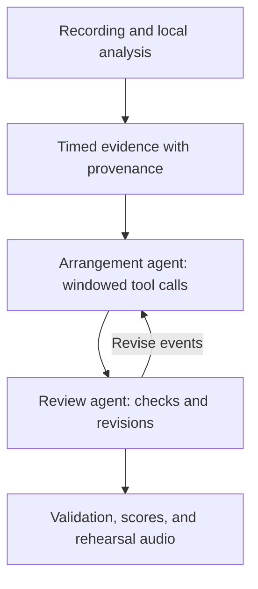

# Vibacappella Agent

Generate **Lead + SATB + VP + Whistle** full scores, individual parts, and rehearsal tracks from recordings using local music-analysis tools and an API LLM. The reusable source is independent of EYKM's form, key, and 3/4 meter; historical fixed chord tables are not used as a general arranger.

This is a runnable **0.1 engineering release** with an end-to-end offline example and automated tests. Musical decisions from a live LLM require provider-specific verification and human review. Delivery status is `exported_draft_needs_review`; passing structural checks does not establish human listening approval.

## Lessons from v1-v3

| Earlier problem | Current workflow constraint |
|---|---|
| Fixed chord templates changed the original harmony | Preserve half-bar candidates, extensions, suspensions, and inversions. Reference harmony can be locked; check defining tones and bass in the sounding parts. |
| Piano themes became Whistle material | Whistle notes must cite flute evidence meeting the confidence threshold. Piano and `other` are not automatically flute. |
| Piano became repetitive block chords or arpeggios | Assign S/A/T from source onsets, pitch classes, and gaps. The LLM selects section textures and can revise individual events. |
| Backing vocals disappeared | Track `vocal_backing` separately from `harmonic_support`, warn about omissions, and distinguish candidates from confirmed original singing. |
| VP was absent or copied simultaneous drum hits | Use drum-onset evidence and section strategies, with one articulation per grid position and release/breathing gaps. |
| Notation and audio diverged | Export from one event score, compare eight MusicXML/MIDI pairs, and record the actual audio engine, library hash, and duration. |
| Reruns were expensive or overwrote previous work | Use separate run directories, cached analysis, conversation checkpoints, event logs, score revisions, and export manifests. |

Historical source is archived under [`../legacy/`](../legacy/README.md). Earlier musical deliverables and technical reports remain local and are not distributed with the repository.

## Workflow



1. **Prepare:** snapshot and hash the input; normalize to WAV through FFmpeg; run six-stem Demucs or supply stems with matching start times and durations.
2. **Analyze:** collect Basic Pitch candidates, optional GAME lead transcription, timing/tempo mappings, half-bar harmony candidates, and band-based drum onsets. Preserve uncertainty.
3. **Arrange:** process at most eight bars per window through `inspect_bars`, `choose_harmony`, `assign_vocal_roles`, `arrange_bars`, `replace_events`, `validate`, and `finish`. Lead/backing/harmonic interpretations are stored as an overlay without rewriting original candidates.
4. **Review:** use the same API model in a fresh review context to inspect evidence and revise events. These are two logical roles, not two Python processes masquerading as LLMs; multiple API keys are unnecessary.
5. **Export:** MusicXML, MIDI, and PDF for the full score and seven parts; full mix, seven isolated tracks, seven part-emphasized practice mixes, no-lead accompaniment, and local `review.html`.
6. **Check:** notation/audio consistency, defining chord tones, inversions, ranges, provenance, ties, monophonic overlap, voice crossing, and breathing. Record unresolved warnings.

Harmony checks establish whether defining tones occur within a segment; they do not prove every instantaneous voicing or chord interpretation is correct. Range, duration, and provenance errors block successful delivery. Crossings, long phrases, and some unused candidates remain reviewable warnings.

## Installation

Python **3.11** or **3.12** is recommended. Orchestration, HTTP, validation, basic MusicXML, and MIDI use the standard library. Audio dependencies run in a separate interpreter so model stacks need not share one environment.

```sh
cd agent_system
python3.11 -m venv .venv
. .venv/bin/activate
python -m pip install -e '.[audio,samples,pdf]'
```

Also install FFmpeg, a local SF2/SF3 SoundFont, and either MuseScore for formal PDFs or a FreeSerif font with music symbols for proof PDFs. First model use may download weights. Models, fonts, and sound libraries are not bundled. Demucs and Basic Pitch compatibility depends on their dependency constraints; separate `analysis.python` and `render.python` environments if necessary. Optional GAME support requires `.[game]` and its own ONNX model directory.

Commands can also run directly from this directory without package installation: `python3 -m vibacappella ...`.

[examples/local-macos.toml](examples/local-macos.toml) records dependencies on the original development machine. Adjust those paths for other machines. The reusable package does not hardcode the earlier project's song data or dependency paths.

## Prime Inference (default)

The integration follows the [Prime documentation](https://docs.primeintellect.ai/inference/overview), using the OpenAI-compatible endpoint `https://api.pinference.ai/api/v1/chat/completions`. The example model is `z-ai/glm-5.3`. Set `PRIME_MODEL` to an exact catalog model ID; capabilities and parameter limits depend on the model. Live Prime calls have not yet been verified with a real key.

Set the key in `agent_system/secrets/prime.env`. Edit an existing file rather than overwriting it:

```dotenv
PRIME_API_KEY=your-api-key
# Optional: PRIME_MODEL=exact-model-id-from-catalog
# Optional: PRIME_TEAM_ID=your-team-id
```

The key needs Inference permission. See `secrets/prime.env.example`. Supported syntax includes `NAME=value`, quoted values, and `export NAME=value`. Values are read literally; shell code is not executed. Environment variables take precedence. Relative secret paths are anchored to `agent_system`, independently of the working directory. Keys are read at runtime, excluded from persisted configuration and logs, and not exported to subprocesses. Actual secret files are ignored by Git.

Requests bill the key owner's personal account by default. `PRIME_TEAM_ID` adds `X-Prime-Team-ID` to each request for team billing. Requests include `usage.include`; response token counts update the persistent budget.

From the `agent_system` directory:

```sh
python3 -m vibacappella doctor --config examples/local-macos.toml
python3 -m vibacappella run path/to/song.wav --config examples/local-macos.toml --run-dir runs/prime-01
```

`examples/local-macos.toml` uses Prime. The portable provider example is `examples/prime.toml`. Existing runs retain their saved configuration; migrate through `resume --config` with compatible analysis and arrangement settings. Parley-specific examples remain available.

## Parley and transport configuration

The authenticated [MIT Parley documentation](https://parley-docs.mit.edu/chat-completions) was checked on 2026-11-13 for `https://parley.api.mit.edu/v1/chat/completions`, Bearer authentication, and OpenAI-format tool calls. Live two-turn tool calls were subsequently verified with Sonnet 4.6 and 5.5.

[examples/parley.toml](examples/parley.toml) supplies the Parley base URL and defaults to `claude-sonnet-5-5`. Enter the key through the terminal; for macOS zsh:

```sh
export PARLEY_MODEL='claude-sonnet-5-5' # Verified with two live tool-call turns
read -s 'PARLEY_API_KEY?Parley API Key: '; echo
export PARLEY_API_KEY
```

`PARLEY_BASE_URL` can override the configured address. The two-turn checks used 1,358 tokens for Sonnet 4.6 and 945 for Sonnet 5.5. The full-song EYKM configuration is `examples/eykm-sonnet55.toml`. Sonnet 5.5 always enables reasoning, so that example uses a 32,000-token output limit and a 600-second timeout. The client does not preserve `thinking` or `thinking_signature`; successful Parley tool round trips do not establish compatibility with every provider's reasoning protocol.

Parley examples read `PARLEY_API_KEY` from the environment. `api_key_env` contains a variable name, never a credential. Keys are excluded from run configuration, request logs, and subprocess environments. Credential-bearing HTTP redirects are not followed.

- `base_url` and `endpoint` form the request URL; the default relative route is `chat/completions`.
- Authentication defaults to `Authorization: Bearer ...`. Adjust `auth_header` and `auth_prefix` only for a documented protocol.
- `tool_mode = "native"` uses native function calling. `"json"` uses a text JSON action protocol for models without native tools that can reliably produce JSON.
- `max_tokens_field` accepts `max_tokens` or `max_completion_tokens`. Model IDs, quotas, context windows, and tool capabilities depend on the account and provider.
- Native Anthropic Messages and OpenAI Responses transports are not implemented. Services exposing only those protocols need an adapter in `llm.py`.
- Only structured notes, harmony, rhythm, text, and tool results are sent to the LLM. Original recordings are not uploaded. The LLM does not directly listen to audio.
- Calls, estimated/actual tokens, and turns per window are bounded. Failed attempts consume budget. No cost estimate is promised for unknown pricing.

## Running the system

Adjust configuration paths for the current machine, then check and run:

```sh
python3 -m vibacappella doctor --config examples/local-macos.toml
python3 -m vibacappella run path/to/song.wav \
  --config examples/local-macos.toml --run-dir runs/song-01
```

Use a new, empty run directory for each song or fresh analysis. Use `resume` to continue existing work.

```sh
# Local analysis only: no API key or LLM charges
python3 -m vibacappella analyze path/to/song.wav --config my.toml --run-dir runs/song-analysis

# Continue LLM work or export in the same run
python3 -m vibacappella resume runs/song-analysis

# Start a new run with corrected evidence matching the audio hash
python3 -m vibacappella run path/to/song.wav --config my.toml \
  --evidence corrected-evidence.json --run-dir runs/song-corrected

# Validate, export, or inspect without calling the LLM
python3 -m vibacappella validate runs/song-analysis
python3 -m vibacappella export runs/song-analysis
python3 -m vibacappella status runs/song-analysis
```

`resume --config ...` can change LLM connection/budget and export settings. Changes to analysis, arrangement, or evidence require a new run to avoid mixing cached work with new parameters. Failures preserve status and checkpoints. Missing PDF/audio tools prevent a partial MusicXML-only result from being marked complete.

API/tool logs and score revisions are stored inside the run. Do not manually edit an active `score.json` or conversation checkpoint; use tool interfaces for normal revisions.

## Complete offline example and tests

```sh
python3 -m unittest discover -s tests -v
python3 -m vibacappella demo --config examples/local-macos.toml --run-dir runs/my-demo
```

`demo` explicitly uses original synthetic test audio, known evidence, and a scripted provider. It exercises tool dispatch, both roles, event scores, note comparisons, sampled audio, and PDF export. It does not establish live LLM arrangement quality or transcription accuracy. Normal `run` and `resume` never silently switch to this substitute.

Generate the review page, PDFs, and mixes locally with the demo command. Run results are excluded from the source repository. See [validation scope](docs/VALIDATION.md).

## Musical limitations

- Demucs `other` is not an isolated flute stem. Whistle rests and an explicit warning are used without reliable flute evidence. Supply `flute.wav` or corrected evidence with credible attribution in a new run. There is no automatic flute classifier.
- GAME has a separate adapter. Default Basic Pitch lead/backing separation produces candidates; polyphonic leakage, harmonics, and vibrato can cause errors. Genuine polyphonic backing transcription needs review.
- Automatic meter estimation uses simple 3/4 and 4/4 accent hypotheses. Configure meters such as 6/8 explicitly or supply timing anchors for changing meter, pickups, and rubato. Beat estimates are not final conducting decisions.
- Editing uses a sixteenth-note grid. Triplets, subtle swing, complex slurs, and full lyric ASR/forced alignment are not implemented. Supplied syllables are retained; missing original lyrics are not fabricated.
- Distributing piano texture among three singers requires selection. Tools provide an editable draft; melodic contour, breathing, timbre, and section development need rehearsal checks.
- `proof` is a project PDF renderer supporting basic notes, rests, accidentals, ties, and syllables. Refine exported MusicXML in MuseScore for formal engraving. `samples` renders local recorded samples rather than exporting through the MuseScore engine.

## Source map

| Files | Responsibility |
|---|---|
| `cli.py`, `storage.py`, `config.py` | Commands, state, locks, checkpoints, configuration, and controlled subprocesses |
| `analysis.py`, `audio_worker.py`, `game.py` | Separation, transcription, timing, harmony, and rhythm evidence |
| `llm.py`, `agent.py` | API transport, budgets, tool schemas, arrangement and review loops |
| `music.py`, `arrange.py`, `validate.py` | Event model, voice assignment, and musical constraints |
| `export.py`, `render.py`, `samples.py`, `proof.py` | MusicXML/MIDI/PDF, sampled and external audio engines, event comparisons |
| `report.py`, `demo.py`, `tests/` | Listening review page, explicit offline example, regression tests |

See the [data contract](docs/DATA_FORMAT.md), [workflow review](docs/WORKFLOW_REVIEW.md), and [sources and inherited code](docs/PROVENANCE.md).
